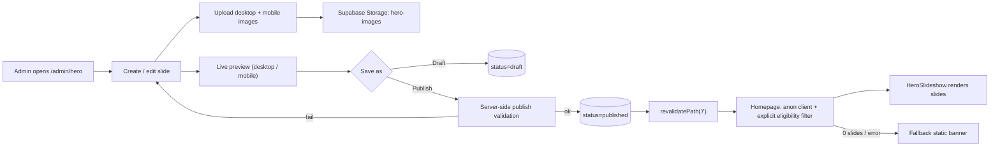
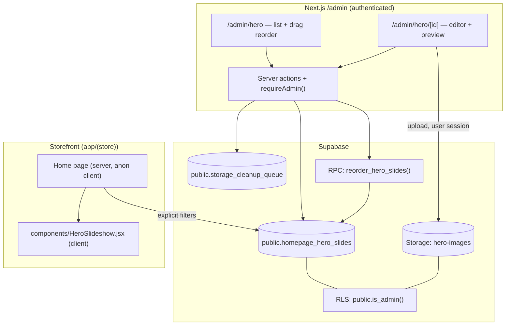

# Architecture & Design Document: Homepage Hero Slideshow Management
**Project**: Nanjai Clothing (`poo-project`)  
**Status**: Revised after review (v2) / Ready for staged implementation  
**Author**: Antigravity  

---

## 0. Revision Log (v2)

| # | Review finding | Resolution (section) |
|---|---|---|
| 1 | Storage policies were a placeholder | Full `storage.objects` policies written (§4.1) |
| 2 | Orphaned images on delete | Store object paths; cleanup queue table; retryable (§4.3, §4.5) |
| 3 | Publish not validated server-side | `validateForPublish()` + DB constraints (§4.4) |
| 4 | Auth on every mutation | `requireAdmin()` guard on all actions incl. storage (§4.4) |
| 5 | Admin session could leak drafts to homepage | Anon client + explicit eligibility filters (§4.6) |
| 6 | Reorder not atomic | `reorder_hero_slides()` transactional RPC (§4.2) |
| 7 | Caching / scheduling unclear | Explicit cache rules (§4.7) |
| 8 | Rigid image dimensions | Aspect-ratio-based validation, configurable (§4.5) |
| 9 | Accessibility gaps | Pause control, labels, focus, alt text (§4.6) |
| 10 | Missing failure/security tests | Added (§7) |

---

## 1. Executive Summary & Objective

The homepage hero ([Hero.jsx](../components/Hero.jsx)) is hard-coded. Every promotion change requires a code edit and redeploy.

This feature moves hero content into Supabase so admins can create, schedule, order, preview and publish promotional slides from `/admin/hero` — **no deployment required**. No new backend service is introduced.

> **Note**: The slideshow is display-only. Discounts, coupons and prices remain handled by existing pricing / `create_order()` logic.

---

## 2. Simple Admin → Homepage Flow



1. Admin creates a slide, uploads images, fills text/CTA.
2. Admin previews, then saves as **Draft** or **Publishes** (server validates).
3. Successful mutation immediately invalidates the homepage cache.
4. Homepage fetches eligible slides with the **anonymous** client; shows fallback banner if none.

---

## 3. High-Level Design (HLD)



Reuses: `public.is_admin()`, `product-images` bucket pattern, `components/DraggableList.jsx`, `lib/supabase-server.js` (admin, cookie-aware) and `lib/supabase-public.js` (anon, storefront).

**Never** use the service-role key in browser code or for admin mutations; RLS stays enabled as the security boundary.

---

## 4. Low-Level Design (LLD)

### 4.1 Database & Storage Migration
File: `supabase/migrations/20261011120000_homepage_hero_slides.sql`

```sql
-- =============================================================================
-- Homepage hero slides + hero-images bucket. Safe to re-run.
-- =============================================================================

create table if not exists public.homepage_hero_slides (
  id                 uuid primary key default gen_random_uuid(),
  title              text not null check (char_length(title) between 1 and 120),
  subtitle           text check (char_length(subtitle) <= 300),
  image_url          text,                       -- public URL (desktop)
  image_path         text,                       -- storage object path (desktop)
  mobile_image_url   text,
  mobile_image_path  text,
  image_alt          text check (char_length(image_alt) <= 200),
  offer_badge        text check (char_length(offer_badge) <= 30),
  button_text        text check (char_length(button_text) <= 40),
  button_url         text,
  text_alignment     text not null default 'center'
                     check (text_alignment in ('left','center','right')),
  text_position      text not null default 'middle'
                     check (text_position in ('top','middle','bottom')),
  overlay_opacity    smallint not null default 40 check (overlay_opacity between 0 and 90),
  display_order      int not null default 0,
  status             text not null default 'draft'
                     check (status in ('draft','published','inactive')),
  starts_at          timestamptz,
  ends_at            timestamptz,
  created_at         timestamptz not null default now(),
  updated_at         timestamptz not null default now(),

  constraint hero_schedule_valid
    check (ends_at is null or starts_at is null or ends_at > starts_at),
  constraint hero_cta_pair
    check ((button_text is null) = (button_url is null)),
  constraint hero_cta_safe_url
    check (button_url is null or button_url ~ '^(/[^/]|/$|https://)'),
  constraint hero_url_path_pair
    check ((image_url is null) = (image_path is null)
       and (mobile_image_url is null) = (mobile_image_path is null)),
  constraint hero_paths_in_bucket
    check ((image_path is null or image_path like 'slides/%')
       and (mobile_image_path is null or mobile_image_path like 'slides/%')),
  -- A published slide must be complete (DB-level backstop for server validation)
  constraint hero_published_complete
    check (status <> 'published' or (image_url is not null and image_alt is not null))
);

create index if not exists hero_slides_eligible_idx
  on public.homepage_hero_slides (status, display_order);

create or replace function public.touch_updated_at() returns trigger
language plpgsql as $$ begin new.updated_at := now(); return new; end; $$;

drop trigger if exists hero_slides_touch on public.homepage_hero_slides;
create trigger hero_slides_touch before update on public.homepage_hero_slides
  for each row execute function public.touch_updated_at();

-- Cleanup queue for storage objects whose deletion failed / is pending
create table if not exists public.storage_cleanup_queue (
  id          bigint generated always as identity primary key,
  bucket_id   text not null,
  object_path text not null,
  attempts    int  not null default 0,
  last_error  text,
  created_at  timestamptz not null default now(),
  unique (bucket_id, object_path)
);

-- ---------------------------------------------------------------------------
-- RLS: table
-- ---------------------------------------------------------------------------
alter table public.homepage_hero_slides enable row level security;
alter table public.storage_cleanup_queue enable row level security;

drop policy if exists hero_public_read on public.homepage_hero_slides;
create policy hero_public_read on public.homepage_hero_slides
  for select using (
    status = 'published'
    and (starts_at is null or starts_at <= now())
    and (ends_at   is null or ends_at   >  now())
  );

-- NOTE: permissive policies are OR-ed, so admins can read ALL rows.
-- The storefront therefore uses the anon client + explicit filters (§4.6).
drop policy if exists hero_admin_all on public.homepage_hero_slides;
create policy hero_admin_all on public.homepage_hero_slides
  for all using ((select public.is_admin()))
  with check ((select public.is_admin()));

drop policy if exists cleanup_admin_all on public.storage_cleanup_queue;
create policy cleanup_admin_all on public.storage_cleanup_queue
  for all using ((select public.is_admin()))
  with check ((select public.is_admin()));

revoke all on public.homepage_hero_slides from anon;
grant select on public.homepage_hero_slides to anon, authenticated;
grant insert, update, delete on public.homepage_hero_slides to authenticated;
grant select, insert, update, delete on public.storage_cleanup_queue to authenticated;

-- ---------------------------------------------------------------------------
-- Storage bucket: public read, admin-only write, 5 MB, jpeg/png/webp
-- ---------------------------------------------------------------------------
insert into storage.buckets (id, name, public, file_size_limit, allowed_mime_types)
values ('hero-images', 'hero-images', true, 5242880,
        array['image/jpeg', 'image/png', 'image/webp'])
on conflict (id) do update
  set public = excluded.public,
      file_size_limit = excluded.file_size_limit,
      allowed_mime_types = excluded.allowed_mime_types;

drop policy if exists "hero_images_public_read"  on storage.objects;
drop policy if exists "hero_images_admin_insert" on storage.objects;
drop policy if exists "hero_images_admin_update" on storage.objects;
drop policy if exists "hero_images_admin_delete" on storage.objects;

create policy "hero_images_public_read" on storage.objects
  for select using (bucket_id = 'hero-images');

create policy "hero_images_admin_insert" on storage.objects
  for insert to authenticated
  with check (
    bucket_id = 'hero-images'
    and (storage.foldername(name))[1] = 'slides'
    and (select public.is_admin())
  );

create policy "hero_images_admin_update" on storage.objects
  for update to authenticated
  using      (bucket_id = 'hero-images' and (select public.is_admin()))
  with check (bucket_id = 'hero-images' and (storage.foldername(name))[1] = 'slides'
              and (select public.is_admin()));

create policy "hero_images_admin_delete" on storage.objects
  for delete to authenticated
  using (bucket_id = 'hero-images' and (select public.is_admin()));
```

Status semantics: `draft` = never shown · `published` = shown inside schedule window · `inactive` = switched off.

Optional: `store_config.hero_autoplay_ms int default 5000`.

### 4.2 Atomic Reorder RPC

```sql
create or replace function public.reorder_hero_slides(p_ids uuid[])
returns void
language plpgsql
security invoker            -- RLS + is_admin still apply
set search_path = public
as $$
declare
  v_total int;
begin
  if not public.is_admin() then
    raise exception 'not authorized' using errcode = '42501';
  end if;

  if p_ids is null or cardinality(p_ids) = 0 then
    raise exception 'empty id list';
  end if;

  if cardinality(p_ids) <> (select count(distinct x) from unnest(p_ids) x) then
    raise exception 'duplicate ids';
  end if;

  -- Serialize concurrent reorders
  lock table public.homepage_hero_slides in share row exclusive mode;

  select count(*) into v_total from public.homepage_hero_slides;
  if v_total <> cardinality(p_ids)
     or exists (select 1 from unnest(p_ids) x
                where not exists (select 1 from public.homepage_hero_slides s where s.id = x)) then
    raise exception 'id list must contain every slide exactly once';
  end if;

  update public.homepage_hero_slides s
     set display_order = o.ord - 1
    from unnest(p_ids) with ordinality as o(id, ord)
   where s.id = o.id;
end;
$$;

revoke all on function public.reorder_hero_slides(uuid[]) from public, anon;
grant execute on function public.reorder_hero_slides(uuid[]) to authenticated;
```

A Postgres function runs in a single transaction: all-or-nothing. New slides get `display_order = max + 1`.

### 4.3 Admin UI

| Route | File | Purpose |
|---|---|---|
| `/admin/hero` | `app/admin/hero/page.jsx` | List: thumbnail, title, status pill, schedule (+ "Scheduled"/"Expired" hint), publish/unpublish toggle, drag-reorder, edit, delete |
| `/admin/hero/new`, `/admin/hero/[id]` | `app/admin/hero/[id]/page.jsx` | Editor form + live preview |
| — | `app/admin/hero/actions.js` | Server actions (§4.4) |
| — | `lib/hero-validation.js` | Shared schema; reused by client form and server |
| — | `components/admin/HeroSlideForm.jsx` | Form fields + uploaders |
| — | `components/admin/HeroImageUploader.jsx` | Validate + upload + preview |

Add "Homepage Hero" to the [admin layout](../app/admin/layout.jsx) nav (already protected by [middleware.js](../middleware.js)).

Editor: form left, preview right with Desktop/Mobile toggle using the real `HeroSlide` component (preview = production). Buttons: **Save Draft**, **Publish**, **Cancel**. Server errors are shown inline per field and as a toast.

### 4.4 Server Actions, Authorization & Validation

Every action starts with the same guard:

```js
// app/admin/hero/actions.js
'use server'
async function requireAdmin() {
  const supabase = createServerClient()            // cookie-aware, user session
  const { data: { user } } = await supabase.auth.getUser()
  if (!user) throw new AuthError('Not signed in')
  const { data: isAdmin } = await supabase.rpc('is_admin')
  if (!isAdmin) throw new AuthError('Not authorized')
  return supabase                                   // same client → RLS applies
}
```

| Action | Guard | Behaviour |
|---|---|---|
| `saveSlide(input, { publish })` | `requireAdmin` | Draft: `validateDraft`. Publish: `validateForPublish`. Insert/update. If an image was replaced, enqueue old path for cleanup. |
| `setStatus(id, status)` | `requireAdmin` | When → `published`, load row and run `validateForPublish`. |
| `reorderSlides(ids)` | `requireAdmin` | `supabase.rpc('reorder_hero_slides', { p_ids: ids })` |
| `deleteSlide(id)` | `requireAdmin` | See §4.5 cleanup. |
| `retryCleanup()` | `requireAdmin` | Re-attempt queued storage deletions. |

All successful mutations call `revalidatePath('/')` and `revalidatePath('/admin/hero')`.

**`validateForPublish(slide)`** (server, `lib/hero-validation.js`):
- `title` non-empty, ≤ 120 chars; `image_alt` present.
- `image_path` present and starts with `slides/`; same for `mobile_image_path` if set.
- Object **exists** in `hero-images` (`storage.from('hero-images').list(dir)` or HEAD on public URL).
- `button_text` and `button_url` both present or both empty.
- `button_url` is a relative path (`/…`, not `//…`) or `https://`; parse with `new URL()`, reject `javascript:`, `data:`, `http:` and protocol-relative.
- `starts_at`/`ends_at` valid ISO dates; `ends_at > starts_at`; warn (not block) if `ends_at` is in the past.
- `text_alignment`, `text_position`, `overlay_opacity` within allowed enums/ranges.

DB constraints (§4.1) are the final backstop if validation is bypassed.

### 4.5 Image Upload, Validation & Cleanup

**Layouts & aspect ratios** (config in `lib/hero-validation.js`, editable without schema change):

| Variant | Target ratio | Rendering | Recommended | Hard minimum width |
|---|---|---|---|---|
| Desktop | ~16:6 (2.4–3.0 accepted) | `object-cover`, center/top focus | 2400×900 | 1280 px |
| Mobile | 4:5 (0.7–0.9 accepted) | `object-cover` | 1080×1350 | 640 px |

Out-of-range ratio → **warning** with crop preview, not a hard reject. Only width below minimum, wrong type, or size > 5 MB are hard errors.

**Upload flow** (browser, user session → storage RLS enforces admin):
1. Client validates type, size, dimensions; shows object-URL preview and specific messages ("File is 7.2 MB, max 5 MB").
2. Upload to `slides/{slideId}/{desktop|mobile}-{uuid}.{ext}` (unique name, never overwritten → no CDN staleness, never shared between slides).
3. Store both `image_url` (public URL) and `image_path` on the row in the **same** `saveSlide` call.
4. If the save fails after upload, the client enqueues the uploaded path for cleanup — the published row never points to a missing image (row is only updated after upload succeeds).

**Delete / replace cleanup** (reliable, retryable):
1. In `deleteSlide`: read the row's paths → insert them into `storage_cleanup_queue` → delete the row (both in one RPC/transaction, or queue-first so paths are never lost).
2. Attempt `storage.remove(paths)`; on success delete queue rows; on failure increment `attempts`, store `last_error`, return a partial-failure warning to the UI.
3. Before removing, confirm no other slide references the path (paths are unique per slide, but check anyway).
4. Admin list shows "N images pending cleanup — Retry" when the queue is non-empty.

### 4.6 Homepage Rendering

**Data fetch** — `app/(store)/page.jsx` (server component):

```js
import { supabasePublic } from '@/lib/supabase-public'   // anon key, NO cookies

async function getHeroSlides() {
  try {
    const now = new Date().toISOString()
    const { data, error } = await supabasePublic
      .from('homepage_hero_slides')
      .select('id,title,subtitle,image_url,mobile_image_url,image_alt,offer_badge,button_text,button_url,text_alignment,text_position,overlay_opacity')
      .eq('status', 'published')
      .or(`starts_at.is.null,starts_at.lte.${now}`)
      .or(`ends_at.is.null,ends_at.gt.${now}`)
      .not('image_url', 'is', null)
      .order('display_order', { ascending: true })
      .limit(10)
    if (error) throw error
    return data ?? []
  } catch (e) {
    console.error('hero slides fetch failed', e)
    return []
  }
}
```

- Anon client ⇒ admin cookies can never change the result, so an admin-specific result can never enter the public cache.
- Explicit filters duplicate RLS on purpose (defense in depth, predictable behaviour).

**`components/HeroSlideshow.jsx`** (client):
- Autoplay default 5000 ms; pauses on hover, focus-within, and when tab hidden.
- **Visible Pause/Play button** (`aria-pressed`); autoplay disabled entirely under `prefers-reduced-motion`.
- Prev/next buttons with `aria-label="Previous slide"/"Next slide"`; dots as buttons with `aria-label="Go to slide N"` and `aria-current`.
- Region: `role="region" aria-roledescription="carousel" aria-label="Promotions"`; each slide `role="group" aria-roledescription="slide" aria-label="N of M"`; hidden slides get `aria-hidden` + `inert` so focus/screen readers never land on them.
- Live region `aria-live="off"` while autoplaying, `"polite"` when user navigates manually.
- Keyboard arrows when focused, touch swipe, visible `focus-visible` rings.
- Cross-fade (CSS opacity) with stacked absolute slides.
- `<picture>` with `<source media="(max-width:767px)" srcSet={mobile_image_url}>` → fallback `image_url`; `alt={image_alt}`.
- First slide `fetchpriority="high"`, rest `loading="lazy"`; fixed container height prevents layout shift.
- Image `onError` → drop that slide; if all fail → static fallback.
- One slide → no arrows/dots/autoplay.

**`components/Hero.jsx`**: `slides.length ? <HeroSlideshow slides={slides}/> : <StaticBanner/>` — the current banner becomes `StaticBanner`. Trust bar unchanged.

### 4.7 Caching & Publication Rules

| Event | Mechanism | Expected latency |
|---|---|---|
| Admin publishes / edits / reorders / deletes | `revalidatePath('/')` in server action | Next request |
| Scheduled `starts_at` / `ends_at` passes | `export const revalidate = 60` on home page | ≤ 60 s (documented tolerance) |
| DB or image failure | try/catch → fallback banner | Immediate |

- The home page must not read cookies/headers (would force dynamic rendering and defeat ISR).
- Verify on the actual hosting target (e.g. Vercel vs self-hosted `next start`) that ISR and `revalidatePath` are honoured; if not, fall back to `dynamic = 'force-dynamic'` with the same anon query.

---

## 5. MVP vs Future Enhancements

| Priority | Features |
|---|---|
| **Must have (MVP)** | Upload images, edit text, CTA, multiple slides, atomic reorder, publish/unpublish |
| **Must have (MVP)** | `requireAdmin` on all actions, table + storage RLS, server publish validation, responsive rendering, fallback banner, storage cleanup queue |
| **Should have (MVP if festival promos are imminent)** | Scheduling, mobile-specific images, live preview, pause/play control |
| **Later** | Click/impression analytics, A/B testing, video banners, free x/y text placement & custom colors, auto image variants (Supabase transforms/AVIF), templates & duplicate, link to real coupons, audience targeting, version history, multi-language |

---

## 6. Implementation Sequence (small, verifiable stages)

1. **DB & security** — migration (table, constraints, RLS, bucket, storage policies, cleanup queue, reorder RPC). Verify with anon/admin SQL tests. Seed 2 sample slides.
2. **Homepage** — `HeroSlide`, `HeroSlideshow`, anon fetch, `StaticBanner` fallback.
3. **Admin listing** — list, status toggle, reorder via RPC, delete with cleanup.
4. **Editor & uploader** — fields, shared validation, uploads, preview, draft/publish.
5. **Cache & scheduling** — wire `revalidatePath`, confirm ISR on the deployment target.
6. **Verification** — run §7.

Each stage is merged and tested before the next begins.

---

## 7. Verification Plan

### Acceptance criteria
| # | Test |
|---|---|
| 1–2 | Create slide with images, text, CTA, order → row has URL + path; objects exist |
| 3 | Preview matches homepage render (desktop & mobile) |
| 4–5 | Publish 3 slides → appear on `/` in order without redeploy |
| 6 | Autoplay every 5 s; arrows, dots, swipe, pause/play work |
| 7 | At 375 px mobile image loads; text readable with overlay |
| 8 | Draft / inactive / expired absent (also via direct anon REST query) |
| 9 | `starts_at` = now+2 min appears within 60 s after; `ends_at` hides it |
| 10 | Non-admin cannot modify |
| 11 | Bad upload / failed request → clear error |
| 12 | No slides / query failure → fallback, page usable |

### Security & failure tests (added in v2)
- Admin logged in and browsing `/` sees **no** draft/inactive/expired slides; cached page for anon also clean.
- Non-admin (anon and authenticated non-admin) cannot insert/update/delete rows, call `reorder_hero_slides`, upload/update/delete in `hero-images`, or upload outside `slides/`.
- Publishing a slide with missing image, missing alt, unpaired CTA, `javascript:` / `http:` / `//evil.com` URL, or `ends_at <= starts_at` is rejected (server action **and** DB constraint via direct API call).
- Upload succeeds but save fails → no row points to the file; file appears in cleanup queue.
- Storage delete fails (simulate) → row removed, path stays in queue, Retry clears it.
- Two concurrent reorder calls → final order is one of the two submitted orders, never mixed; duplicate/missing IDs rejected.
- Publish refreshes `/` on the deployed environment without redeploy.
- Broken image URL on one slide → slide skipped; all broken → fallback.
- Keyboard-only: tab reaches controls, focus never enters hidden slides; screen reader announces slide N of M; reduced-motion disables autoplay.
