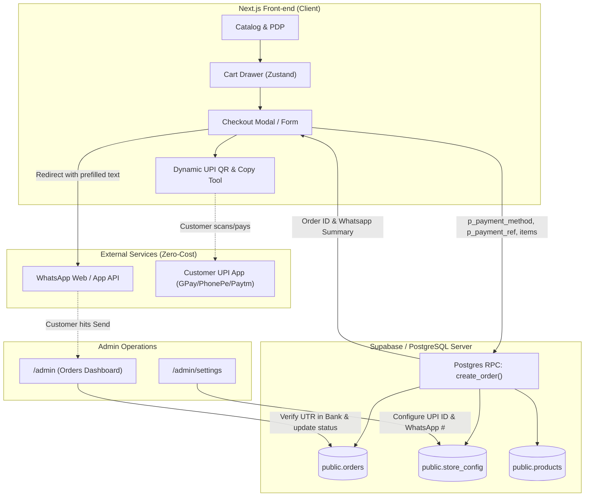
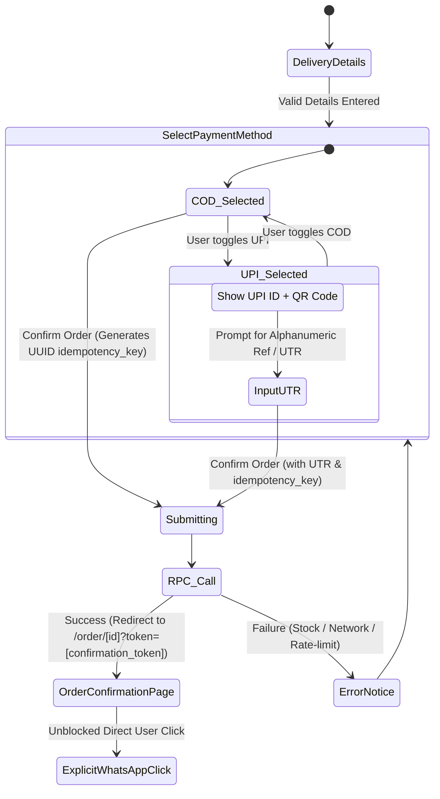

# Architecture & Design Document: Zero-Cost Payment Flow (COD & Direct UPI)
**Project**: Nanjai Clothing (`poo-project`)  
**Status**: Planned / Ready for Implementation  
**Author**: Antigravity  

---

## 1. Executive Summary & Objective

Nanjai Clothing is launching as a direct-to-consumer (D2C) ethnic apparel brand. Setting up traditional payment gateways (Razorpay, Cashfree, Stripe) introduces:
- High setup friction (business registration, GST validation, KYC approval wait times).
- Transaction charges ($2\% - 3\%$ per transaction + $18\%$ GST on fees).
- Integration overhead and webhook failure edge-cases.

This design document outlines a **Zero-Cost Payment Flow** utilizing **Cash on Delivery (COD)** and **Direct UPI (Unified Payments Interface)** coupled with **Supabase Database Validation** and **WhatsApp Confirmation**.

---

## 2. High-Level Design (HLD)

### 2.1 System Context & Component Interaction



### 2.2 Payment Method Specifications

| Method | Upfront Cost | Transaction Fee | Flow & Customer Experience | Settlement Risk & Mitigation |
| :--- | :---: | :---: | :--- | :--- |
| **Cash on Delivery (COD)** | ₹0 | ₹0 | Customer inputs delivery info, selects COD, clicks **Confirm Order**. | **Risk**: RTO (Return to Origin) / Fake orders.<br>**Mitigation**: WhatsApp automated verification required before shipping. |
| **Direct UPI** | ₹0 | ₹0 | System generates dynamic UPI deep link & QR code (`upi://pay?pa=...`). Customer pays and pastes the **12-digit UPI UTR / Reference ID**. | **Risk**: Fake or forged UTR string.<br>**Mitigation**: `payment_status` remains `pending` until admin matches UTR in their banking app. |

---

## 3. Low-Level Design (LLD)

### 3.1 Database Schema Enhancements

#### A. Table `public.orders`
We will extend `public.orders` to decouple fulfillment status (`status`) from financial settlement (`payment_status`):

```sql
-- Migration: Add payment tracking fields to orders
alter table public.orders 
  add column if not exists payment_method text not null default 'COD'
    check (payment_method in ('COD', 'UPI', 'BANK_TRANSFER')),
  add column if not exists payment_status text not null default 'pending'
    check (payment_status in ('pending', 'paid', 'failed', 'refunded')),
  add column if not exists payment_reference text; -- Stores 12-digit UTR / Transaction ID
```

#### B. Table `public.store_config`
Add configuration keys for store merchant details:
```sql
insert into public.store_config (key, value) values
  ('upi_id', 'nanjai@upi'),
  ('upi_payee_name', 'Nanjai Clothing')
on conflict (key) do nothing;
```

---

### 3.2 Server-Side Logic: `create_order` RPC Signature & Flow

The `create_order` function acts as the security boundary preventing client price tampering.

#### New RPC Signature:
```sql
create or replace function public.create_order(
### 3.1 Database Schema Enhancements

#### A. Table `public.orders`
We will extend `public.orders` to decouple fulfillment status (`status`) from financial settlement (`payment_status`), add client idempotency support, and secure confirmation access:

```sql
-- Migration: Add payment tracking, idempotency, and secure access token to orders
alter table public.orders 
  add column if not exists payment_method text not null default 'COD'
    check (payment_method in ('COD', 'UPI', 'BANK_TRANSFER')),
  add column if not exists payment_status text not null default 'pending'
    check (payment_status in ('pending', 'paid', 'failed', 'refunded')),
  add column if not exists payment_reference text,               -- Alphanumeric reference / UTR
  add column if not exists idempotency_key text unique,          -- Enforces request-level deduplication
  add column if not exists confirmation_token uuid not null default gen_random_uuid(); -- High-entropy view token
```

#### B. Table `public.store_config`
Add configuration keys for store merchant details:
```sql
insert into public.store_config (key, value) values
  ('upi_id', 'nanjai@upi'),
  ('upi_payee_name', 'Nanjai Clothing')
on conflict (key) do nothing;
```

---

### 3.2 Server-Side Logic: `create_order` RPC Signature & Flow

The `create_order` function acts as the security boundary preventing client price tampering and enforcing idempotency.

#### RPC Signature:
```sql
create or replace function public.create_order(
  p_customer_name      text,
  p_customer_phone     text,
  p_address            text,
  p_items              jsonb,
  p_payment_method     text default 'COD',
  p_payment_reference  text default null,
  p_idempotency_key    text default null
) returns jsonb
```

#### Security & Business Rules:
1. **Idempotency Guard**:
   If `p_idempotency_key` is provided and an order already exists with that key:
   - Return the existing order record immediately (preventing duplicate charging/records on retry).
2. **Validation**:
   - `p_customer_name`, `p_customer_phone`, `p_address` non-empty and within character limits.
   - `p_customer_phone` validated via regex (`^[6-9]\d{9}$` for 10-digit Indian mobile numbers).
   - `p_items` array valid and length between 1 and 50.
   - `p_payment_method` in `('COD', 'UPI', 'BANK_TRANSFER')`.
   - If `p_payment_method = 'UPI'`:
     - Validate that `p_payment_reference` is provided and matches a flexible alphanumeric format (6–30 characters, `^[a-zA-Z0-9_-]{6,30}$`). Do *not* hardcode an exact 12-digit requirement, as banking apps (e.g. Axis, HDFC, Google Pay UPI Txn ID vs Bank Ref) vary.
3. **Price Calculation**:
   - Query `public.products` for authoritative prices and `in_stock = true`.
   - Calculate server-side `subtotal` and `total_amount = subtotal + delivery_fee`.
4. **Insert Order**:
   - Set `status = 'pending'`, `payment_status = 'pending'`.
   - Store generated `confirmation_token`.
5. **Return Payload**:
   - Return `{ id, confirmation_token, items, subtotal, delivery_fee, total_amount, whatsapp_number }`.

---

### 3.3 Client-Side Component Architecture

#### A. `CheckoutForm.jsx` State Machine



#### B. Secure Order Confirmation Screen (`app/(store)/order/[id]/page.jsx`)
* **Privacy & Access Control (Fixing Finding B)**:
  - Do **NOT** expose full customer PII (phone number, full delivery address) publicly through a predictable or brute-forceable UUID order ID alone.
  - Require the `confirmation_token` query parameter: `/order/[id]?token=[confirmation_token]`.
  - RPC or query checks `id = p_id AND confirmation_token = p_token`.
  - Display masked details (e.g. `Anand K.`, `Madurai, PIN: 625009`, `Items: 2`, `Total: ₹1,098.00`).
* **Eliminating the Popup Blocker**:
  - The page displays an unblocked, prominent green **"Open WhatsApp to Complete Order"** button.
  - Clicking this link uses standard user gesture navigation (`target="_blank"` or direct link) which is never blocked by mobile Safari or Chrome.
* **Workflow Status Update**:
  - When the customer taps the WhatsApp button, trigger a safe client RPC `mark_order_contacted(order_id, confirmation_token)` to update `status = 'contacted'` as a workflow progression marker.

#### C. Dynamic UPI Deep-link & QR Code Generation
For UPI payments:
```text
upi://pay?pa={upi_id}&pn={payee_name}&am={total_amount}&cu=INR&tn=Nanjai_Order_{id}
```
* **QR Code Rendering**: Rendered client-side using inline SVG/Canvas for instant loading.
* **Mobile Deep-Link**: A button **"Pay via UPI App (GPay / PhonePe / Paytm)"** triggers the native app chooser on mobile devices.

#### D. Enriched WhatsApp Message Payload with Clickable Product Links
* **Server-Authoritative Product URLs**:
  - The client only passes `p_items: [{ id, quantity }]`.
  - The server resolves the canonical URL for each product (`/product/{id}`) from the verified database record, preventing client link-spoofing or malicious redirect injection.
  - The canonical base URL is pulled from `store_config.site_url` or standard host configuration.
* **Open Graph Metadata**:
  - Product pages at [`/product/[id]`](file:///Users/macbook/workspace/poo-project/app/(store)/product/[id]/page.jsx) already implement Open Graph tags (`og:title`, `og:image`, `og:url`, `og:description`). When sent in WhatsApp, WhatsApp automatically converts valid URLs to clickable links and renders rich link preview cards.

```text
🛍️ *New Order: #NL-849201*
━━━━━━━━━━━━━━━━━━━━━━
👤 *Customer:* Anand Kumar
📞 *Phone:* +91 98765 43210
📍 *Address:* 14, Kamarajar Salai, Madurai - 625009

📦 *Items Ordered:*

*Yaadhum Oore Tee*
Qty: 1 · ₹549.00
Product link: https://nanjaiclothing.com/product/00000000-0000-0000-0000-000000000101

*Thiruvalluvar Minimalist Tee*
Qty: 1 · ₹499.00
Product link: https://nanjaiclothing.com/product/00000000-0000-0000-0000-000000000103

━━━━━━━━━━━━━━━━━━━━━━
💰 *Subtotal:* ₹1,048.00
🚚 *Delivery:* ₹50.00
💵 *Order Total:* ₹1,098.00
💳 *Payment Method:* Direct UPI
🔖 *UPI Ref / UTR:* 429184029184
⚠️ *Payment Status:* Pending Verification
```

---

### 3.4 Security & Operational Hardening

1. **Server-Enforced Status & Payment Transitions (Fixing Finding D)**:
   - RLS strictly forbids anonymous users from mutating `status` (except transitioning to `contacted` via secure token) and completely forbids modifying `payment_status`.
   - Only validated admins (`is_admin() = true`) can transition `payment_status` from `'pending'` to `'paid'`, `'failed'`, or `'refunded'`.
2. **Server-Resolved Product Metadata & Link Integrity**:
   - Product titles, prices, and links in `cart_items` are derived strictly from Postgres rows during `create_order`, never accepted from client payloads.
3. **Flexible Reference Format (Fixing Finding C)**:
   - Avoid rigid 12-digit requirements. Accept alphanumeric strings `[a-zA-Z0-9_-]{6,30}`.
   - Admin UI explicitly states: *"Verify against actual banking transaction before marking as Paid."*
4. **CSV Formula Injection Defense**:
   - In [`app/admin/page.jsx`](file:///Users/macbook/workspace/poo-project/app/admin/page.jsx), prefix any CSV cell starting with `=`, `+`, `-`, or `@` with a single apostrophe (`'`).
5. **Accurate Lifetime Revenue Aggregate**:
   - Query a database-level RPC / aggregation instead of calculating revenue over only the latest 100 loaded rows.

---

### 3.5 Schema Reconciliation & Script Cleanup

1. **Unified Schema Truth**:
   - Ensure `supabase/schema.sql` matches all migration states including `p_customer_phone`, `p_payment_method`, `p_payment_reference`, and `p_idempotency_key`.
2. **Script Hygiene**:
   - Clean up obsolete manual scripts (`create-user.js`, `update_rpc.sh`, `fix_grants.sh`, `replace.py`, `update_orders.py`) to prevent configuration confusion and accidental execution of stale code.

---

## 4. Phased Implementation Sequence

To minimize risk and deliver working value early, implement in 5 distinct phases:

### Phase 1: Database Foundation & Schema Reconciliation
- [ ] Create migration `20261011_add_payment_and_idempotency.sql`.
- [ ] Add columns: `payment_method`, `payment_status`, `payment_reference`, `idempotency_key`, `confirmation_token`.
- [ ] Update `create_order` RPC with idempotency, phone validation, flexible reference validation, and new columns.
- [ ] Create `mark_order_contacted` RPC with confirmation token validation.
- [ ] Insert `upi_id` and `upi_payee_name` into `store_config`.
- [ ] Reconcile `supabase/schema.sql` to match.

### Phase 2: Order Confirmation Page (`/order/[id]`)
- [ ] Create [`app/(store)/order/[id]/page.jsx`](file:///Users/macbook/workspace/poo-project/app/(store)/order/[id]/page.jsx).
- [ ] Implement token-based order retrieval with masked PII.
- [ ] Add explicit, unblockable "Open WhatsApp to Complete Order" button with automatic status update to `contacted`.

### Phase 3: Checkout UI Upgrade (COD & Direct UPI)
- [ ] Generate client-side UUID idempotency key on checkout submission.
- [ ] Add payment selector tabs: **Cash on Delivery** vs. **Direct UPI**.
- [ ] For UPI: Add QR code, deep link, and flexible reference/UTR input.
- [ ] Redirect on success to `/order/[id]?token=[confirmation_token]`.

### Phase 4: Admin Dashboard & Payment Operations
- [ ] Display `payment_method`, `payment_status`, and `payment_reference` in the order rows.
- [ ] Add admin-only action: **"Mark Payment as Paid"** (guarded by RLS).
- [ ] Add CSV export sanitization against formula injection.
- [ ] Add UPI settings inputs to [`/admin/settings`](file:///Users/macbook/workspace/poo-project/app/admin/settings/page.jsx).

### Phase 5: Verification & Testing
- [ ] Delete stale maintenance scripts.
- [ ] Run `supabase db reset` to verify fresh installation and migrations.
- [ ] Perform end-to-end tests:
  1. COD order placement $\rightarrow$ confirmation page $\rightarrow$ WhatsApp.
  2. UPI order placement $\rightarrow$ UTR submission $\rightarrow$ Admin bank verification $\rightarrow$ Mark Paid.
  3. Retry request with identical idempotency key $\rightarrow$ verify deduplication.

